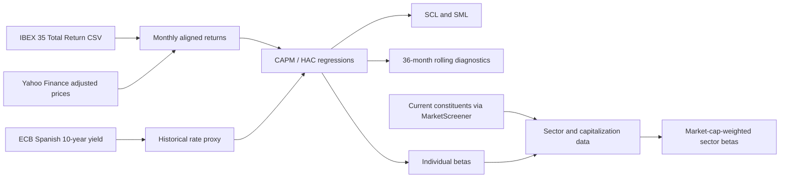

# IBEX 35 | Empirical CAPM Research

**Systematic risk · Equity returns · Econometric diagnostics · Rolling CAPM · Sector exposures**

[](requirements.txt) [](notebooks/CAPM_IBEX35_CSV_TR_BCE.ipynb) [](LICENSE) [](https://github.com/Jamarma12/IBEX35-CAPM-Research/actions/workflows/validate.yml)

> **Research project.** Empirical assessment of the Capital Asset Pricing Model for Spanish listed equities, using an IBEX 35 **total-return** benchmark, ECB historical interest rates, HAC-robust estimation, and rolling-window diagnostics. The notebook also retrieves the contemporary IBEX 35 universe for market-cap and sector-level beta analysis.

**[Open notebook](notebooks/CAPM_IBEX35_CSV_TR_BCE.ipynb)** · **[Run in Google Colab](https://colab.research.google.com/github/Jamarma12/IBEX35-CAPM-Research/blob/main/notebooks/CAPM_IBEX35_CSV_TR_BCE.ipynb)** · **[Methodology](docs/METODOLOGIA.md)** · **[Data provenance](docs/DATOS_Y_FUENTES.md)** · **[Reproducibility](docs/REPRODUCIBILIDAD.md)**

**Status:** Offline notebook syntax and packaged-data checks pass. Live end-to-end execution against market-data providers **has not been verified**. Illustrative project functionality is described below; no unverified empirical findings or investment claims are presented.

---

## At a glance

| Econometric research | Market and sector intelligence |
|---|---|
| CAPM regressions on monthly **excess returns** | Automated discovery of **current IBEX 35 constituents** |
| Individual betas, alpha, HAC inference and R² | Yahoo-compatible tickers and sector mapping |
| Security Characteristic Lines (**SCL**) | Company-level market capitalization |
| Security Market Line (**SML**) and realized return comparison | Sector market capitalization aggregation |
| **36-month rolling** model assessment | **Market-cap-weighted sector betas** |
| Historical CAPM cost of equity and rate-only sensitivity | Exportable tables and visualizations |

### Research workflow



## Methodology

The estimated market model is:

$$
R_{i,t}-R_{f,t}=\alpha_i+\beta_i(R_{m,t}-R_{f,t})+\varepsilon_{i,t}.
$$

Monthly adjusted company returns are aligned with monthly IBEX 35 **Total Return** returns and an interest-rate proxy derived from the ECB's Spanish 10-year sovereign series. Regressions use OLS with **HAC (Newey–West) covariance**, configured with three lags. The notebook plots individual Security Characteristic Lines, compares cross-sectional realized and CAPM-implied returns on the SML, and performs rolling 36-month estimation.

Historical CAPM cost of equity uses an in-sample historical market premium; the supplementary **current-rate sensitivity** replaces only the historical average rate with the latest available reference, holding beta and the historical premium fixed. This is *not* an ex-ante equity valuation or a demonstration of predictive validity.

For complete details, see [methodology and caveats](docs/METODOLOGIA.md).

## Datasets and provenance

| Input | Provider | Role |
|---|---|---|
| IBEX 35 Total Return (`IBEXTR`), daily levels | [Investing.com](https://es.investing.com/indices/ibex-total-return-historical-data) | Dividend-reinvested market benchmark |
| Adjusted individual equity prices | [Yahoo Finance](https://finance.yahoo.com/) | Company returns |
| Spanish 10-year sovereign yield | [ECB Data Portal](https://data.ecb.europa.eu/) | Historical rate proxy and sensitivity scenario |
| Current IBEX 35 membership and sectors | [MarketScreener](https://es.marketscreener.com/) | Dynamic cross-sectional universe |

The included [`data/ibex35_total_return_investing.csv`](data/ibex35_total_return_investing.csv) has **3,102 daily records (6 Oct 2014–6 Nov 2026)**. Removing the incomplete November 2026 observation month yields **145 complete month-end levels (Oct 2014–Oct 2026)** and **144 monthly market returns**. This is the available benchmark history, **not a promise that all companies have this coverage**.

**Third-party data note:** The packaged Investing.com CSV originates with an external provider. The GPL-3.0 license applies to original code, not necessarily to the dataset. Confirm applicable source permissions before further redistribution. A historical price-only `^IBEX` series is **not interchangeable** with IBEX 35 Total Return.

## Quick start

Requires **Python 3.10+** and internet connectivity for the live providers.

```bash
git clone https://github.com/Jamarma12/IBEX35-CAPM-Research.git
cd IBEX35-CAPM-Research
python -m venv .venv
# Activate on macOS/Linux:
source .venv/bin/activate
# On Windows PowerShell instead:
# .venv\Scripts\Activate.ps1
python -m pip install -r requirements.txt
jupyter lab
```

Open [`notebooks/CAPM_IBEX35_CSV_TR_BCE.ipynb`](notebooks/CAPM_IBEX35_CSV_TR_BCE.ipynb) and run its cells in order. The notebook looks for the bundled CSV both from the repository root and from the `notebooks/` directory. In **Colab**, the notebook can open via the link above, but the CSV must also be uploaded into `/content/` using the original filename **`Datos históricos del IBEX 35 con Div..csv`**, or its path must be added to `CSV_CANDIDATES`.

Offline validations:

```bash
python scripts/validate_repository.py
python -m unittest discover -s tests -v
```

These checks do **not** establish that the live provider APIs currently respond or that the model's output has been reviewed. Read the [reproducibility guide](docs/REPRODUCIBILIDAD.md) before citing empirical results.

## Repository structure

```text
IBEX35-CAPM-Research/
├── notebooks/
│   └── CAPM_IBEX35_CSV_TR_BCE.ipynb  # Main study, demo and extended universe
├── data/
│   └── ibex35_total_return_investing.csv
├── docs/
│   ├── METODOLOGIA.md
│   ├── DATOS_Y_FUENTES.md
│   ├── REPRODUCIBILIDAD.md
│   ├── PUBLICACION_GITHUB.md
│   └── CAMBIOS.md
├── scripts/validate_repository.py
├── tests/test_repository.py
├── .github/workflows/validate.yml
├── requirements.txt
├── CITATION.cff
├── LICENSE
└── README.md
```

## Scientific limitations

- **Survivorship bias:** today's constituents are not a historical membership reconstruction.
- **Risk-free proxy:** a 10-year Spanish sovereign yield is not a month-matched cash risk-free return; term and sovereign risk remain.
- **Returns and comparability:** company price adjustments and total-return-index conventions can differ; company histories need not share the same starting month.
- **In-sample identity:** the annualized gap between arithmetic realized returns and fitted CAPM returns is related algebraically to estimated alpha on the same sample, so it is not a separate validation test.
- **Prediction:** rolling estimates should be assessed separately from in-sample fit; historical inputs must not be replaced by today's interest rate when evaluating forecasts in the past.
- **Provider stability:** current membership, ticker mapping and live data access can change; date and validate every empirical run.

**Results and figures:** This README intentionally does not present simulated or unverified results. The publication-ready next step is to execute the complete notebook, save a curated SML, one rolling forecast diagnostic and a sector-beta chart, and document the sample and execution date.

## License, citation and disclaimer

Original project code is distributed under [GNU GPL v3](LICENSE). Third-party datasets have separate terms. Citation metadata: [`CITATION.cff`](CITATION.cff). This repository is for **research and education**, **not investment advice**.

<details>
<summary>Resumen en español</summary>

Estudio empírico del CAPM aplicado a valores del IBEX 35 con índice de **retorno total**, proxy histórica de tipos del **BCE**, regresiones **HAC**, análisis de ventanas móviles de 36 meses y extracción automatizada de componentes actuales, capitalizaciones bursátiles y betas sectoriales ponderadas. Las comprobaciones locales del repositorio están superadas; falta verificar una ejecución completa con los proveedores de datos en directo.

</details>
